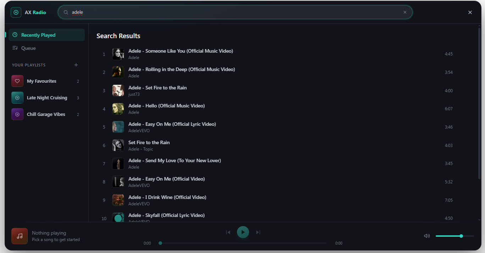

# SOPHISTICATED RADIO SYSTEM
This radio system is based on YT search engine using Google API
To make it work, please put your key in .env.example i remove .example

YouTube Data API v3 key used for in-app music search.
 1. Go to https://console.cloud.google.com/apis/credentials
 2. Create a project (or pick one), enable the "YouTube Data API v3"
 3. Create an API key and restrict it to that API

## Commands

| Command | Who | What it does |
| --- | --- | --- |
| `F6` (`kradio`) | Everyone | Open your radio, or the car radio when you're in a vehicle |
| `/dj` | Everyone | Open the DJ booth you're standing at |
| `/radiohud` | Everyone | Show or hide the nearby "now playing" widget |
| `/createdj` | DJ permission | Create a DJ booth with the step-by-step creator |
| `/editdj` | Booth owner / admin | Re-open the creator for the booth you're standing at |
| `/removedj` | Booth owner / admin | Remove the booth you're standing at |
| `/radioadmin` | Radio admins | Open the admin panel |

## DJ booth creator

`/createdj` (or **Place new booth** in the admin panel) walks you through five steps, with the keys for
each step shown on screen:

1. **Console**: spawn a prop (cycle models from `Config.DjModels`), pick an **existing object** in the world
   (great for MLOs), or draw a free **ox_target interaction box**.
2. **Sound**: indoors it shows which interior will play the music and lets you set how far it's heard
   (muffled) outside. Outdoors, set a **radius**, or draw a **custom area** corner by corner, with a height
   and a fade-out distance.
3. **Disco lights**: place moving spotlights, laser fans, mirror balls and strobes, each with a colour (or
   rainbow) and speed. They animate to `Config.DiscoLights.bpm` whenever the booth is playing. **M**
   picks what marks each light: the glowing dot, nothing, or a prop from `Config.DiscoLights.fixtures`
   (stands on the floor/truss you aim at, hangs upside down from a ceiling, scroll to rotate).
4. **Access**: press **E** to pick which ESX jobs can use the console, each with a minimum grade. Pick
   none and everyone can. Anyone can still open the booth's radio to browse, edit playlists and change
   settings, but playing, skipping, queueing, volume and tempo are blocked with a notice (and rejected
   by the server). Radio admins can always use it.
5. **Save**: review and save. `/editdj` (or **Edit setup** in the admin panel) reopens it later.

Booth setups are stored in the `settings` column of `radio_dj_stations` (added automatically).

## Nearby "now playing" widget

When you're in range of a DJ booth (or inside the room it's in), a small card shows the song, artist,
cover and time. Players can turn it off, switch to a compact style, show it for any radio nearby, or
drag it anywhere on screen from the radio's **Settings → Nearby now playing → Move widget**.
Turn it off server-wide with `Config.NowPlayingWidget = false`.

## Admin panel

Radio admins (`Config.AdminAce` ACE permission, or an ESX group listed in `Config.AdminGroups`) get an
**Admin** section in the radio, also reachable with `/radioadmin`:

- **Live radios**: everything playing on the server, with who started it, where it is, distance from
  you, players nearby and whether you can hear it. Set a waypoint, teleport, stop it, or ban the player.
  Also "Stop near me" and "Stop all" for emergencies.
- **DJ booths**: every booth with its location, owner and what it's playing. Rename, remove, locate,
  stop, or place a new one.
- **Bans**: ban players from DJ booths only, or from every radio, for 1 hour to permanent, with a
  reason they're shown. Bans are enforced server-side and saved in the `radio_bans` table (created
  automatically).
- **Activity**: recent plays, admin actions, bans and booth changes, so you can see who played what.

